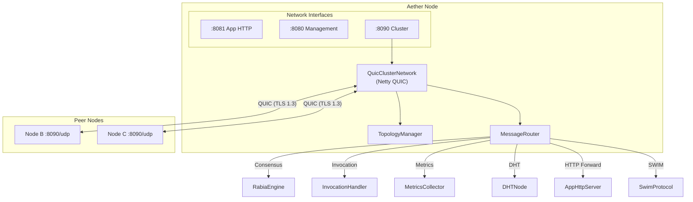
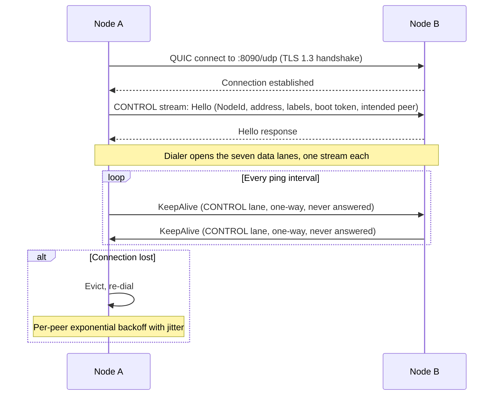
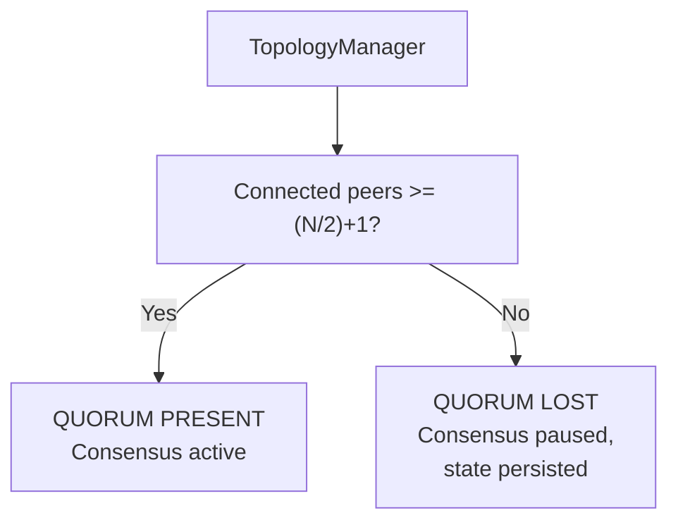
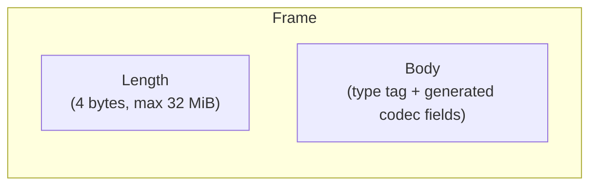
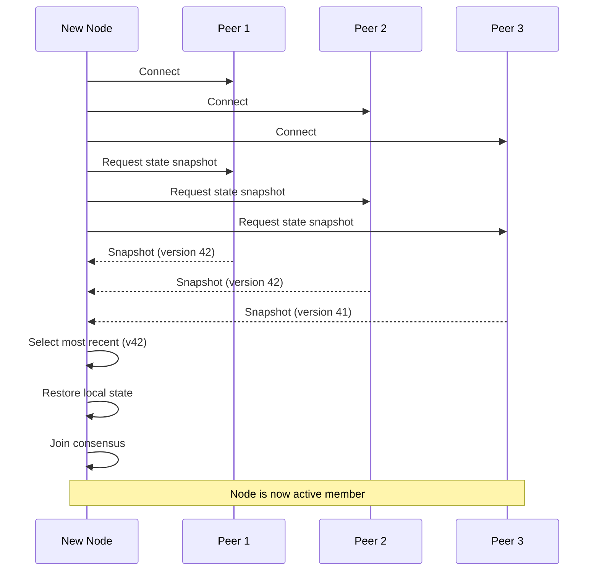
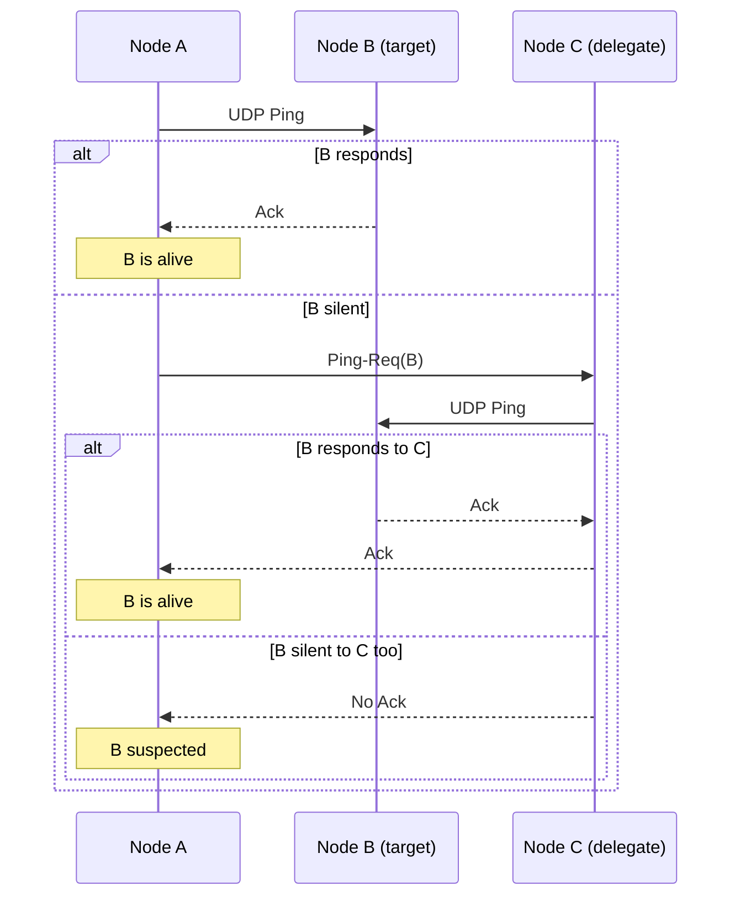

# Networking and Transport

**Status:** Current for the transport mechanics below. Open item: certificate rotation currently restarts the QUIC server rather than swapping the TLS context in place (see [Known Limitations](../reference/known-limitations.md#transport-certificate-rotation-restarts-the-quic-server)).

This document describes the cluster transport layer, topology management, and message routing.

## Network Architecture



## QuicClusterNetwork

Raw QUIC transport (not HTTP/3) for all inter-node cluster communication, built on Netty's QUIC codec with TLS 1.3 inside the QUIC handshake — no separate TLS negotiation. The ALPN protocol identifier is `aether-cluster/1`. It is the only cluster transport.

Each message is one length-prefixed frame (4-byte length, at most 32 MiB) whose body is the binary encoding of the `Message.Wired` object through the generated codec registry: a numeric type tag followed by the record's fields. There is no envelope and no protocol-version field.

### Connection Management



- Peer list configured at startup (no external service registry)
- Automatic reconnection: a link found dead is evicted and re-dialed with a short per-peer backoff, and a 5 s reconciler tick re-dials any configured peer that is not connected, with a per-peer exponential backoff and jitter. QUIC 0-RTT early data is not configured.
- A peer's link is dead-detected by write failure or by the receipt sweep: the QUIC idle timeout is disabled, so a link that stays open but receives no frame on any lane for 8 ping intervals is evicted. The KeepAlive on CONTROL is what keeps a quiet healthy link from being evicted.
- Backpressure is per lane stream. The CONSENSUS lane stream has a Netty write watermark of 256 KiB low and 1 MiB high; other lanes use Netty's default. A write to a stream that is not writable is refused on every lane except CONSENSUS and DHT; a CONSENSUS frame, and a DHT frame to a peer whose channel is still active, is retried up to 200 times at 25 ms and, if the retries run out, dropped with a debug log line. A write reported as sent means the transport accepted it locally: there is no acknowledgement, and delivery is earned by the layer above (Rabia retransmit, the DHT quorum collector, caller deadlines).
- Frames for a peer that is not connected go to a per-peer offline buffer of at most 10,000 frames, each held at most the offline-buffer cap (30 s by default, taken from the cluster timeout configuration); when the buffer is full the oldest frame is dropped.
- Automatic certificate rotation: renewal fires after 40% of the remaining validity has passed (40% of the lifetime elapsed for a fresh certificate, 60% remaining) and restarts the QUIC server with the new certificate
- SWIM health detection on separate UDP port (cluster port + 100)

### Quorum Detection



The transport does not decide quorum. `QuicClusterNetwork` counts its CONNECTED and EVICTED peers for log lines and for the connected-peer count the topology API reports; whether quorum is present is decided by the membership layer (`QuorumLossDetector`) and the Rabia engine. A 5-node cluster tolerates 2 simultaneous failures. When quorum is lost, the engine pauses and rejects writes with `QuorumPaused`, and a node on the minority side self-fences (`Runtime.halt(2)`) after the split timeout; consensus state is memory-only, with snapshot-only persistence. See [Guarantees](../reference/guarantees.md) section 3 and [Consensus](01-consensus.md).

## MessageRouter

Multiplexes all inter-node messages over QUIC streams. A connection carries eight long-lived lanes, one QUIC stream each, and a message's lane is declared by its type:

| Lane | Index | Carries |
|------|-------|---------|
| CONSENSUS | 0 | Rabia proposals, votes, decisions, batches, `SyncRejected`; forwarded apply requests |
| KV | 1 | Community placement, governor authority and community health messages; the KV-sync snapshot request and response |
| METRICS | 2 | ClusterSync ping/pong, deployment and source metrics |
| INVOKE | 3 | Cross-node slice invocation requests and responses |
| FORWARD | 4 | HTTP, entity and stream forwards, replication |
| DHT | 5 | DHT puts, gets, removes, digests, migration |
| CONTROL | 6 | Hello, KeepAlive, node discovery, leader pre-vote, worker metadata manifests |
| SYNC | 7 | Rabia `SyncRequest` and `SyncResponse`, worker metadata chunks |

Each message type is routed to its handler:

| Message Type | Handler | Description |
|-------------|---------|-------------|
| Consensus messages | RabiaEngine | Rabia protocol votes and batches |
| InvocationRequest/Response | InvocationHandler | Cross-node slice calls |
| MetricsPing/Pong | MetricsCollector | Leader-to-node metrics exchange |
| DHT messages | DHTNode | Artifact storage operations |
| HttpForward messages | AppHttpServer | HTTP request forwarding |
| SWIM messages | SwimProtocol | Worker group membership |

### Routing Pattern

```java
// Targeted delivery - not broadcast
router.route(targetNodeId, message);

// Async delivery - non-blocking
router.routeAsync(() -> new ReactionMessage(...));
```

The MessageRouter is a targeted delivery system, not a broadcast bus. Each message specifies its destination node.

## Wire Format

There is no envelope. Each message is a frame on its lane's stream:



| Part | Description |
|------|-------------|
| length | Frame length prefix; a frame above 32 MiB is refused |
| type tag | Numeric tag identifying the message record (framework tags in `SystemTags`, slice tags from the codec registries) |
| fields | The record's fields, written by the compile-time generated `@Codec` codec (no reflection) |

Sender and correlation identifiers are fields of the messages that need them. The `Hello` handshake message carries no version field, so there is no version negotiation; see [Known Limitations](../reference/known-limitations.md).

## Topology Management



### Node Discovery

Nodes discover each other via configured peer list. No external service registry (Consul, etcd, etc.) needed. On startup:
1. Connect to known peers
2. Request state snapshot from cluster
3. Restore local state from most recent snapshot
4. Join consensus and begin accepting work

## SWIM Protocol (Worker Groups)

For worker groups outside the core consensus layer, Aether uses SWIM (Scalable Weakly-consistent Infection-style Membership) for failure detection:



### SWIM Configuration

| Parameter | Default | Description |
|-----------|---------|-------------|
| `period` | 1s | Probe interval |
| `probeTimeout` | 500ms | Wait for Ack |
| `indirectProbes` | 3 | PingReq targets |
| `suspectTimeout` | 5s | SUSPECT -> FAULTY |
| `maxPiggyback` | 8 | Updates per message |

### SWIM Properties

| Property | Value |
|----------|-------|
| Detection | O(1) per node per round |
| Dissemination | Piggybacked on ping/ack messages |
| Transport | UDP (Netty `NioDatagramChannel`) |
| Encryption | AES-256-GCM (see [10-security.md](10-security.md)) |
| Incarnation counter | Refutes false suspicions (higher = more recent) |
| Member states | ALIVE -> SUSPECT -> FAULTY |

### Piggybacked Dissemination

Membership changes (join, leave, suspect, confirm) are piggybacked on existing ping/ack messages rather than broadcast separately. This provides O(log N) dissemination with zero additional network messages.

## Related Documents

- [01-consensus.md](01-consensus.md) - Rabia protocol that uses this transport
- [05-worker-pools.md](05-worker-pools.md) - SWIM protocol for worker group membership
- [10-security.md](10-security.md) - mTLS and gossip encryption
