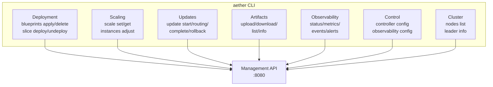
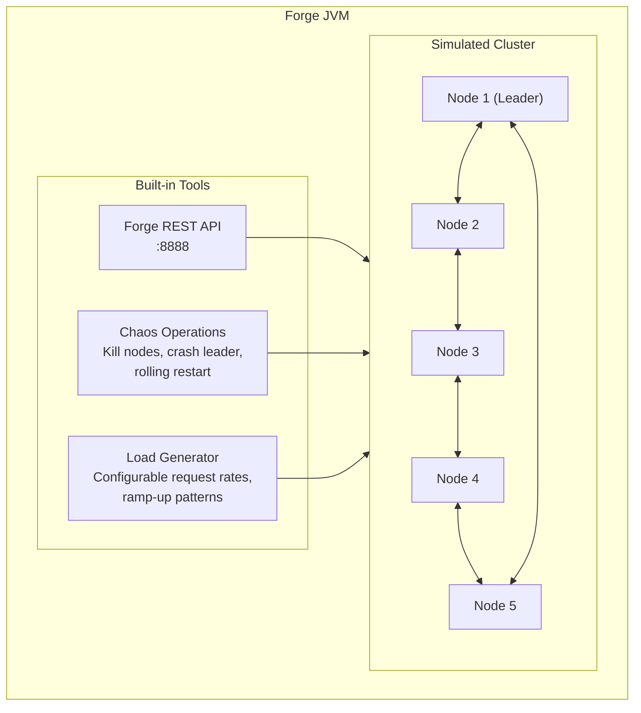

# Management and Tooling

**Status:** Current

This document describes the CLI, Management API, and Forge simulator. The web dashboard was removed in 1.0.0-rc5 (see [Dashboard](#dashboard)).

## CLI

37 commands organized by function, supporting both single-command and interactive REPL modes.

### Command Categories



### Key Commands

| Command | Description |
|---------|-------------|
| `aether blueprints apply <file>` | Deploy blueprint from TOML |
| `aether blueprints delete <id>` | Remove blueprint and undeploy slices |
| `aether status` | Cluster status: nodes, slices, health |
| `aether metrics` | Current metrics snapshot |
| `aether scale <artifact> --min N --max M` | Configure auto-scaling |
| `aether deploy <coords> --rolling` | Begin rolling deployment |
| `aether deploy promote <id>` | Advance deployment |
| `aether artifacts push <group:artifact:version>` | Push local artifact to cluster repository |
| `aether alerts list` | View active alerts |
| `aether observability depth set <artifact>#<method> <threshold>` | Set per-method observability depth |

### REPL Mode

```bash
$ aether
aether> status
Cluster: 5 nodes, leader: node-1
Slices: 3 active, 8 instances total
...
aether> blueprint apply commerce.toml
Deployed: 2 slices, 5 instances
aether> exit
```

## Management API

190+ REST endpoints covering all cluster operations
[verified: `aether/aether-management-api/.../route/ManagementRoute.java` — direct enum count].
None of them carry a `/v1` (or any version) path segment; the table below reflects the actual
route prefixes, not a versioned scheme the code does not implement.

### Endpoint Categories

| Category | Base Path | Endpoints |
|----------|-----------|-----------|
| **Cluster** | `/api/v1/cluster` | topology, status, generation, scale, config, provisioning, membership |
| **Blueprints** | `/api/v1/blueprints` | CRUD operations |
| **Slices** | `/api/v1/slices` | list, status, topology, config |
| **Metrics** | `/api/v1/metrics` | snapshot, per-node, per-slice, transport, timeouts |
| **Scaling** | `/api/v1/scale` | set scaling config |
| **Deploy** | `/api/v1/deploy` | start (canary/blue-green/rolling), promote, rollback, complete |
| **Artifacts** | `/repository` | upload (write-once, release versions only), download, list, info, archive (`DELETE`; metrics under `/api/v1/artifacts/metrics`) |
| **Alerts** | `/api/v1/alerts` | thresholds, active alerts, history |
| **Controller** | `/api/v1/controller` | config, status, scaling decisions |
| **Observability** | `/api/v1/observability` | per-method depth and config, get/set/delete |
| **Prometheus** | `/api/v1/metrics/prometheus` | Prometheus scrape endpoint |

### WebSocket Endpoints

| Endpoint | Description |
|----------|-------------|
| `/ws/events` | Cluster event stream (new events only, no replay on connect) |
| `/ws/status` | Node status updates |

All WebSocket endpoints push data - no polling required.

### Authentication

All endpoints require API key authentication:

```
X-Api-Key: <key>
```

See [10-security.md](10-security.md) for RBAC configuration.

## Forge (Local Development)

Single-JVM multi-node simulator for local development and testing.

### Architecture



### Features

| Feature | Description |
|---------|-------------|
| **5-node cluster** | Full Rabia consensus on localhost |
| **REST API** | Load and chaos control, cluster status, event timeline (port 8888) |
| **Chaos operations** | Kill nodes, crash leader, rolling restart |
| **Load generation** | Configurable rates with ramp-up |
| **Artifact resolution** | From local Maven repository |
| **Full DHT** | Replication mode: FULL (all nodes) |

### Running Forge

```bash
cd aether/forge
mvn exec:java
# Forge REST API at http://localhost:8888
```

Deploy a blueprint, generate load, kill nodes - observe cluster behavior.

## Dashboard

The management dashboard (`/dashboard` on a node, the web UI on Forge's port) was removed in
1.0.0-rc5. A new one will be written from scratch and is not a 1.0 gate. Until it lands, the CLI
and the Management API are the supported operator surfaces; `/ws/status` and `/ws/events` remain
available for programmatic live feeds. Alert threshold evaluation is unaffected: it never depended on
a dashboard client and runs on every node.

## E2E Testing

Testing is split across three layers:

| Layer | Count | Description |
|-------|-------|-------------|
| Unit tests | 10,686 | All modules, `mvn verify` |
| Forge integration | 21 | In-process EmberCluster tests (cluster formation, chaos, deployments) |
| Docker integration | 14 suites, ~50 scripts | 5-node Docker cluster on target host (smoke, chaos, scaling, streaming, security, deployment, resources, artifacts, database, observability, network, edge-cases) |

Docker integration tests run via `aether/tests/integration/run-tests.sh --env docker` against a target host. See [integration test README](../../tests/integration/README.md) for setup and environment variables.

## Related Documents

- [10-security.md](10-security.md) - API authentication and RBAC
- [07-observability.md](07-observability.md) - Metrics and live feeds
- [02-deployment.md](02-deployment.md) - Blueprint operations
